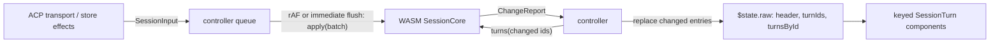

# Design

## Context

See proposal.md (Why) and the querymt change `add-agent-session-core` (the module's API, D4–D5 there). Current desktop facts that shape this design:

- **Session state today.** `AgentsStore.activeSession` (`src/lib/stores/agents.svelte.ts`) is deep `$state` and is replaced on each update by `applySessionNotification` (`src/lib/domain/session-updates.ts`). It is also mutated in place (`applySessionNotificationNow`: `sessionId`, `tool.runId`). Loads go through `activeSessionFromLoadResponse` and `prependOlderHistory` (`session-snapshot.ts`).
- **Turn building.** `buildSessionConversation` (`session-conversation.ts`) builds turns and their HTML (`renderMarkdownToHtml`). It is called by `ActiveSessionView.svelte`, `SessionDelegatesBubble.svelte` and the session page.
- **Chunk batching.** `handleSessionNotification` already batches text chunks per animation frame. Updates for a session that is not active are dropped. Drained sidecar updates (`applyingDrainedUpdates`) are deduplicated with `recentSessionUpdateKeys`.
- **Logs.**
  - Rust: `src-tauri/src/sidecar.rs` emits `querymt://agent/log` once per stdout line, retains 200 entries per agent (`MAX_LOG_LINES`), and serves them through `get_agent_logs`.
  - JS: `ensureAgentLogSubscription` copies `logsByAgent` for each line. Only `src/routes/agents/+page.svelte` reads it.
- **Perf harness.** `src/lib/perf/` holds `session-load-fixture.ts` (synthetic snapshot plus notifications), the vitest benches and the budgets in `scripts/check-session-load-benchmark.mjs`, which run in `.github/workflows/performance.yml`.
- **ACP.** The desktop talks to agents only through the ACP SDK (`src/lib/querymt/acp-client.ts`) and already advertises the standard `session: { compaction: {} }` client capability (`buildClientCapabilities`, ACP `CompactionCapabilities`), so compaction arrives as standard `compaction_update` / `compaction_summary_chunk` updates. This change keeps the capability and every ACP request as they are.
- **Web hosting.** `tauri.conf.json` sets no CSP, so WebAssembly instantiation is allowed. The embedded build is served by `qmtcode` through `mime_guess`, which maps `.wasm` to `application/wasm`.

## Goals / Non-Goals

**Goals:**
- One session reducer (the module). TypeScript keeps transport, effects and presentation only.
- Work per update is proportional to what changed.
- Every check runs offline on generated data.

**Non-Goals:**
- Background sessions receiving live updates while not active. That stays as today: refresh on return.
- Changing ACP requests or the agent-side capabilities.

## Decisions

### D1. Vendored, pinned module
- `scripts/session-core/update.mjs <latest|nightly|vX.Y.Z>` reads the querymt `release.json` (`session_core_wasm`), downloads the archive, and verifies its sha256 the same way `scripts/release/resolve-qmtcode.mjs` does.
- It unpacks into `src/lib/session-core/vendor/` and writes `vendor/PIN.json` (`version`, `commit`, `sha256`, `schema_version`).
- The vendored files are committed, so offline builds, CI and the embedded build need no download.
- `src/lib/session-core/schema.ts` holds `EXPECTED_SCHEMA_VERSION`. The update script refuses an archive whose schema version differs unless it is run with `--accept-schema`.
- *Alternative considered:* downloading at build time. Rejected because it breaks offline builds and makes CI depend on GitHub.

### D2. Loader
- `loadSessionCore(): Promise<SessionCoreModule>` initialises once and caches the promise; the call is retried after a failure.
  - Browser: `init(new URL('./vendor/agent_session_core_bg.wasm', import.meta.url))`.
  - Vitest: the bytes are read with `fs` and passed to `init`.
- It checks `schemaVersion()` against `EXPECTED_SCHEMA_VERSION`. A mismatch is an error.
- App start calls the loader in the background. Opening a session awaits it, and a failure sets `sessionRenderFailure` (message plus Retry), which the session page shows instead of the transcript.

### D3. SessionController
`src/lib/session-core/controller.svelte.ts`. One controller per open session:

- **Batching.**
  - `dispatch(input)` queues the input. Text and thought chunks flush on the next animation frame, as today. Every other input flushes the queue immediately, in order.
  - One flush is one `apply` call.
- **State.**
  - `header`, `turnIds` and `turnsById` are `$state.raw`.
  - A flush replaces `turnsById` with a shallow copy in which only the ids in the change report get new objects. `turnIds` is replaced only when turns were added or removed.
  - No deep reactivity, and no in-place mutation outside the controller.
- **Not a wire format.** `SessionInput` is the module's in-process API. The transport still receives standard ACP messages; the store only wraps each one (or a client-side event such as an optimistic prompt) as an input. Standard ACP `session/update` notifications, compaction included, pass through unchanged inside `acp_notification`.
- **The store builds inputs.** `AgentsStore` keeps transport and effects and turns each event into a `SessionInput`:

  | Today | Input |
  |---|---|
  | `activeSessionFromLoadResponse` after `session/load` / attach | `snapshot_loaded` |
  | `applySessionNotificationNow` | `acp_notification` (`replayed: applyingDrainedUpdates`) |
  | `loadOlderHistory` → `prependOlderHistory` | `history_page` |
  | optimistic prompt in `sendPromptToActiveSession` / launches | `prompt_optimistic` |
  | prompt response or failure | `prompt_completed` / `prompt_failed` |
  | `acceptSessionRuntime` / `projectSelectedExecution` | `runtime_observed` |
  | `applyInputStateNotification` | `input_state` |
  | `applyUndoStack` | `undo_stack` |
  | `setSessionMode` / config writes confirmed | `config_options` |
  | delegation notifications | `delegation_update` |
  | `fetchToolContent` result | `tool_content` |

- **Removed with the switch.** `recentSessionUpdateKeys`, `snapshotUserMessageIds` and `reconcileOptimisticUserPrompt`, because the module does the dedup and the echo matching.
- **Effects stay in the store.** Catalog refresh on summary changes, runtime refresh and notifications. The store derives them from `ChangeReport.header_changed` and the header before and after the flush.
- **Lifecycle.** `dispose()` calls `free()`. A test checks that evicted and closed controllers are freed.

### D4. Presentation cache and keyed rendering
- `src/lib/session-core/presentation.ts` keeps today's presentation logic from `session-conversation.ts` (`buildTurnPresentation`, reasoning grouping, markdown, change stats). It is now a function of one module turn.
- Results are memoised in a `Map` keyed by `turnId:revision`, bounded to the turns of cached sessions.
- `ActiveSessionView` renders `{#each turnIds as id (id)}<SessionTurn turn={turnsById[id]} />`. A turn whose object identity is unchanged neither re-renders nor recomputes HTML.
- The three `buildSessionConversation` callers read the controller instead. `SessionDelegatesBubble` reads the last turn id.
- The turn-window virtualisation (`session-turn-window.ts`) is kept and is fed with `turnIds`.

### D5. Recent-session cache
- An LRU of 5 controllers, keyed by `agentId:sessionId`.
- Selecting a cached session shows its controller at once and still issues the normal load. The load's `snapshot_loaded` replaces the state in the same controller, and the scroll position is preserved by turn id.
- Evicting a controller frees it.
- Notifications for non-active sessions are still dropped, as today. The refresh on return covers them.

### D6. Logs on demand
- **Rust (`sidecar.rs`):**
  - A per-app subscriber count changes through new commands `subscribe_agent_logs` and `unsubscribe_agent_logs`.
  - Every line is still appended to the 200-entry retention buffer.
  - When the count is above zero, a 50 ms flush task emits `querymt://agent/logs` with `{ agentId, entries: [...] }` in order. When it is zero, nothing is emitted.
  - `session_load_telemetry::record_log_emit` counts batches.
- **JS:**
  - `src/routes/agents/+page.svelte` owns a small `agentLogs` module. On mount it calls `get_agent_logs` and subscribes; on destroy it unsubscribes.
  - Entries are kept in a non-deep ring of 200 per agent, with a version counter for reactivity.
  - `logsByAgent` and `ensureAgentLogSubscription` are removed from `AgentsStore`.
- **Embedded:** `listenAgentLogs` is already a no-op there, so this is unchanged.

### D7. Offline harness and counters
- **Generator.** `src/lib/perf/lorem/` produces a seeded generator (mulberry32) of snapshots and live ACP notification streams: markdown, code, diffs, ANSI output, large tool results, compactions, delegations. It replaces `session-load-fixture.ts`, whose shape it keeps.
  - The module's golden traces from querymt are vendored with the module (`vendor/traces/`) and used for the differential and embedded checks.
- **Scripted agent.** `src/lib/perf/fake-agent.ts` connects two in-memory streams through `ndJsonStream` and a small JSON-RPC responder. It answers `initialize`, `session/list`, `session/load`, `querymt/session/history` and `prompt` from the generator. The real `DesktopAcpClient` runs against it.
- **Offline guard.** In the perf vitest setup, `fetch`, `WebSocket` and `child_process.spawn` throw. Any scenario that tries the network or a sidecar therefore fails.
- **Counters.** `src/lib/perf/counters.ts` provides `count(name)`. It is a no-op unless `import.meta.env.VITE_PERF_COUNTERS` is set, which the perf config sets.
  - Call sites: turn presentation computes, `SessionTurn` renders, catalog and sidebar `$derived` recomputes, log state writes, module `apply` calls.
- **Scenarios** (spec: Backend-free performance checks):
  - A: stream 2,000 updates into 1x and 4x histories.
  - B: open a session at 0.125x, 1x, 2x and 4x.
  - C: A→B→A switching.
  - D: catalog isolation while streaming.
  - E: 10,000 log lines with the page closed. The Rust part is a unit test; the JS part asserts zero log state writes.
- **Gates.** `scripts/check-session-load-benchmark.mjs` gains counter limits and the 4x/1x ratio bound (≤ 1.5) next to the existing time budgets. Counters are recorded but not gated before the switch (baseline). Gates turn on in the task that delivers each behaviour.

### D8. Differential check before deletion
Before the TypeScript reducer is removed, `src/lib/session-core/differential.test.ts` applies the vendored traces and generated sessions through both paths. It compares a normalised projection: turn order, user text, assistant text, tool ids, status and output, compactions, usage and run state. Any intentional difference is listed in that file with its reason. The old path is deleted only when the test passes.

## Risks / Trade-offs

- **[No published module yet]** → Groups 1–2 (harness, logs) do not need it. Group 3 can use a locally built `dist/` from querymt's `scripts/session-core-wasm/build.sh` (`update.mjs --from-dir`) until a nightly exists.
- **[Behaviour drift from today]** → D8 differential check; the store's existing tests are kept and moved to the controller.
- **[Async module init delays the first session]** → It is started at app launch. The module is small, and instantiation is measured in scenario B.
- **[Leaked WASM memory]** → Controllers are always freed on eviction and dispose, enforced by a test.
- **[A future CSP blocks WASM]** → A note in `tauri.conf.json` review: a CSP must include `'wasm-unsafe-eval'`.
- **[Bundle size]** → About 600 KiB gzipped, loaded once and cached by the webview. Accepted.

## Migration Plan

1. Harness and baseline; logs on demand. Both ship independently.
2. Vendor the module and the loader; the controller is wired behind the store; the differential test passes.
3. Switch rendering, the cache and the debug panel; turn the gates on.
4. Delete the TypeScript reducer and regenerate the types.

Rollback: revert the release. No persisted data or wire format changes.
